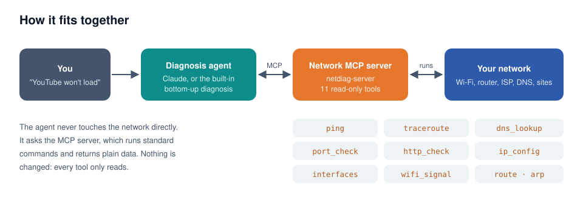
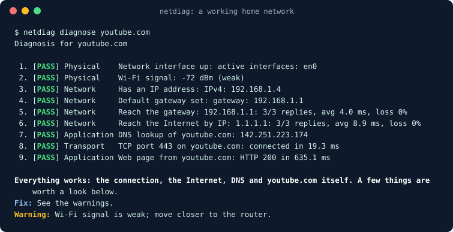
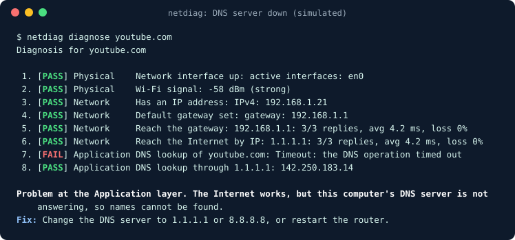
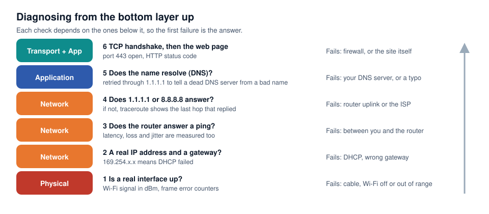
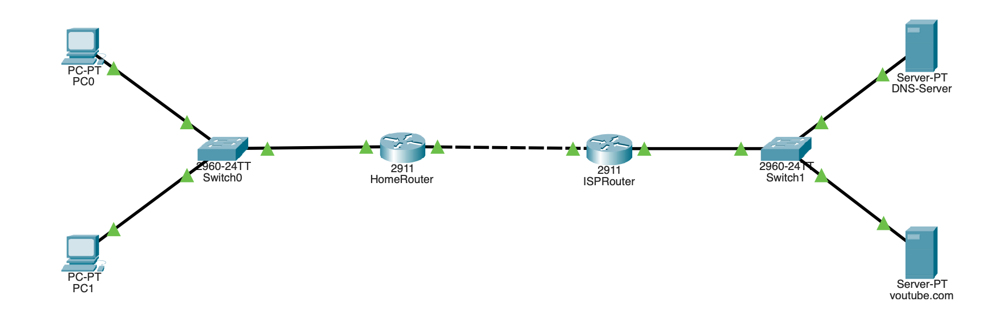
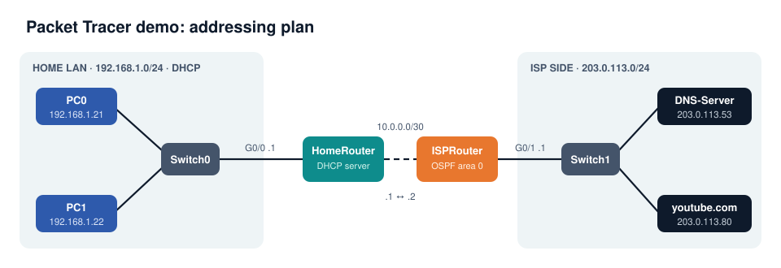
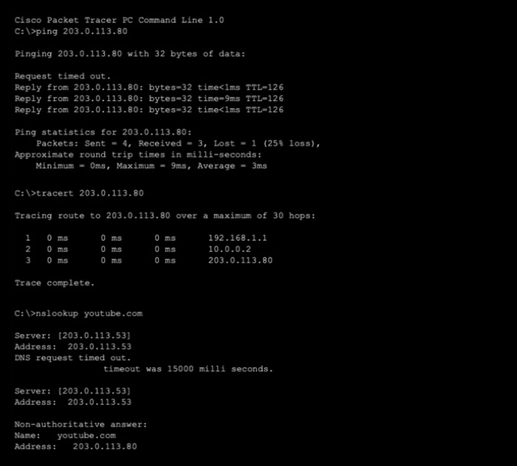

<div align="center">

# Network MCP Server with a Diagnosis Agent

**Tells you which network layer is broken, and how to fix it.**

[](https://github.com/ZANYANBU/network-mcp-diagnosis-agent/actions/workflows/tests.yml)


[](LICENSE)

21CSC302J Computer Networks · SRM Institute of Science and Technology

</div>

When the Internet stops working you only see the symptom: *"YouTube won't load."* The cause can sit at any layer: a weak Wi-Fi signal, a missing IP address, a wrong gateway, a broken route at the ISP, or a DNS server that has stopped answering.

This project gives an AI agent the same tests a network engineer would run, through the **Model Context Protocol (MCP)**, plus a diagnosis method that works **from the bottom layer up** and stops at the first failure.

<p align="center"></p>

## Contents

- [What it does](#what-it-does)
- [Quick start](#quick-start)
- [How the diagnosis works](#how-the-diagnosis-works)
- [The tools](#the-tools)
- [Live demo in Cisco Packet Tracer](#live-demo-in-cisco-packet-tracer)
- [Use it from Claude](#use-it-from-claude)
- [Project layout](#project-layout)
- [Syllabus mapping](#syllabus-mapping)
- [Team](#team)

## What it does

| Part | Command | Needs an API key |
|---|---|---|
| **MCP server** with 11 read-only network tools | `netdiag-server` | No |
| **Diagnosis**: every check, bottom-up, with a plain-English answer | `netdiag diagnose youtube.com` | No |
| **Agent**: ask in your own words and Claude picks the tools | `netdiag-agent "YouTube is not loading"` | Yes |

A real run on a home network:

<p align="center"></p>

And the same command when the DNS server stops answering (simulated, as in the tests):

<p align="center"></p>

## Quick start

Python 3.10 or newer.

```bash
git clone https://github.com/ZANYANBU/network-mcp-diagnosis-agent.git
cd network-mcp-diagnosis-agent
python3 -m venv .venv
source .venv/bin/activate          # Windows: .venv\Scripts\activate
pip install -e ".[test]"
```

```bash
netdiag diagnose youtube.com       # full check, no AI needed
netdiag ping 8.8.8.8
netdiag traceroute 8.8.8.8
netdiag dns youtube.com --server 1.1.1.1
netdiag ipconfig
netdiag wifi
```

Add `--json` to `diagnose` for machine-readable output.

### The agent

```bash
export ANTHROPIC_API_KEY=...       # from console.anthropic.com
netdiag-agent "YouTube is not loading"
netdiag-agent                      # interactive
```

The agent starts the MCP server itself, hands Claude its tools, and prints each tool call as it happens.

## How the diagnosis works

<p align="center"></p>

Each layer depends on the ones below it, so the first failure is the answer. Two checks do extra work to give a precise diagnosis:

- **Internet unreachable:** a traceroute to `8.8.8.8` finds the last hop that replied, which separates "your router's uplink" from "inside the ISP".
- **DNS fails:** the same lookup is retried through `1.1.1.1`. If that works, your DNS server is at fault; if not, the name itself is wrong.

Even when everything passes, it warns about packet loss, high latency, jitter and a weak Wi-Fi signal.

## The tools

| Tool | Layer | What it tells you |
|---|---|---|
| `interfaces` | Physical, data link | Up or down, addresses, MAC, speed, frame errors |
| `wifi_signal` | Physical | Signal in dBm: strong, ok or weak |
| `ip_config` | Network | IPv4 address, default gateway, DNS servers |
| `ping` | Network | Replies, packet loss, latency, jitter |
| `traceroute` | Network | Every router on the path, and where replies stop |
| `route_table` | Network | The routing table, including the default route |
| `arp_table` | Data link | IP-to-MAC pairs on the local network |
| `dns_lookup` | Application | Name to IP, through the system DNS or a chosen server |
| `port_check` | Transport | A TCP three-way handshake to a port |
| `http_check` | Application | HTTP status code and response time |
| `diagnose` | All | The whole bottom-up sequence in one call |

**Safe by design.** Every tool only reads; none changes a setting. Host names are validated, and commands run as argument lists without a shell, so a request like `8.8.8.8; rm -rf /` is refused.

## Live demo in Cisco Packet Tracer

The [`packet-tracer/`](packet-tracer) folder holds a ready-made network, [`Network-Diagnosis-Demo.pkt`](packet-tracer/Network-Diagnosis-Demo.pkt), built and tested in Packet Tracer 9.0.1.

<p align="center"></p>

<p align="center"></p>

- **Home LAN** `192.168.1.0/24`: the PCs get their addresses from HomeRouter's DHCP server.
- **Link between routers** `10.0.0.0/30`, with OSPF area 0 on both routers.
- **ISP side** `203.0.113.0/24`: a DNS server that resolves `youtube.com`, and the web server it points to.

The same checks the agent runs, typed on PC0 in the saved network:

<p align="center"></p>

The demo breaks one layer at a time (a shut switch port, a wrong gateway, a removed OSPF network, the DNS service turned off) and diagnoses each live. Step-by-step instructions, the router configurations and what to say are in [`Packet-Tracer-Live-Demo.pdf`](packet-tracer/Packet-Tracer-Live-Demo.pdf).

## Use it from Claude

**Claude Code**

```bash
claude mcp add network-diagnosis -- /full/path/to/.venv/bin/netdiag-server
```

**Claude Desktop** (`claude_desktop_config.json`)

```json
{
  "mcpServers": {
    "network-diagnosis": { "command": "/full/path/to/.venv/bin/netdiag-server" }
  }
}
```

Any other MCP client works the same way: it starts `netdiag-server` and talks to it over standard input and output.

## Project layout

```
netdiag/
  tools.py        the read-only network checks, one function each
  parse.py        turns ping, traceroute, route and ARP output into data (Windows, macOS, Linux)
  diagnose.py     the bottom-up diagnosis and its plain-English report
  server.py       the MCP server
  agent.py        the Claude agent that uses the server
  cli.py          the netdiag command
tests/            parsers and every fault scenario
packet-tracer/    the demo network, router configs and the demo guide
docs/             diagrams, screenshots and the presentation slides
```

### Tests

```bash
pytest
```

The tests feed saved command outputs from all three operating systems into the parsers, and run the diagnosis on a made-up network broken one layer at a time: link down, DHCP failure, wrong gateway, a routing break inside the ISP, a dead DNS server, a misspelt name and a closed port. They run on Windows, macOS and Linux on every push.

## Syllabus mapping

| Unit | Where it shows up |
|---|---|
| 1 · Introduction to networks | Interfaces, transmission media, Wi-Fi signal, latency, jitter, packet loss |
| 2 · Addressing | IPv4, subnet masks, DHCP and 169.254 addresses, default gateway |
| 3 · Routing | Routing table, default route, traceroute and TTL, OSPF in the demo |
| 4 · Medium access control | MAC addresses, ARP, frame error counters |
| 5 · Transport and application | TCP handshake, ports, DNS, HTTP |

The [presentation slides](docs/presentation/Network-MCP-Diagnosis-Agent-slides.pdf) walk through each unit with diagrams.

## Team

| Name | Register number |
|---|---|
| ANBU CHELVAN | RA2411003011803 |
| Charith Reddy B | RA2411003011823 |
| Rupesh Reddy | RA2411003011831 |
| Basith Nistar | RA2411003011771 |
| Adhityan | RA2411003011764 |

Released under the [MIT License](LICENSE).
